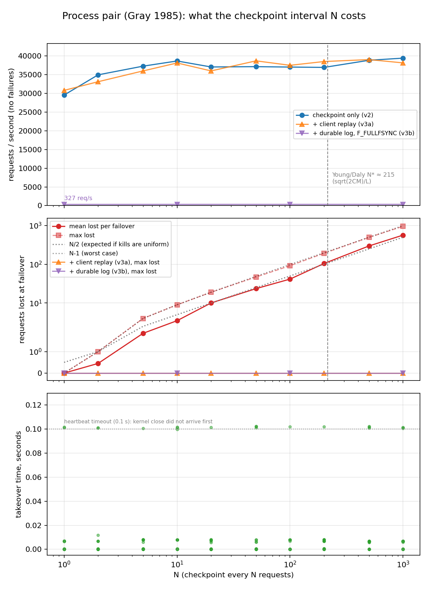

# Results

One laptop (M-series MacBook Air), Python 3.9, all three processes on localhost. For each N in
{1, 2, 5, 10, 20, 50, 100, 200, 500, 1000}: 20 trials, primary killed with `kill -9` at a uniform random
time 1.0 to 2.5 s into a 150,000-request run. Throughput measured separately with no kill. Then the
same again with the two fixes from Gray's paper switched on (see section 5). 420 failovers total.
Raw data in `results/*.csv`, chart in `results/tradeoff.png`, produced by `plot.py`.

## 1. What checkpointing costs

| N | req/s (no failures) | vs N=1000 |
|---|---|---|
| 1 | 29,558 | -25% |
| 2 | 34,958 | -11% |
| 5 | 37,280 | -5% |
| 10 | 38,663 | -2% |
| 100 | 37,038 | -6% |
| 1000 | 39,426 | 0 |

Checkpointing on every request costs a quarter of throughput. By N=5 you are within 5% of the ceiling
and from N=10 on the differences are run-to-run noise. The knee is between N=5 and N=10.

From these numbers: per-request latency with checkpointing amortised away is L = 25.4 µs, and one
checkpoint (a ~20-byte line to a socket on the same machine) costs C = 8.5 µs.

## 2. What checkpointing rarely costs

Lost work tracks the model. Mean lost per failover is about N/2, max is about N-1. Kills are uniform
in time, so the primary is on average halfway to its next checkpoint when it dies.

| N | mean lost | max lost |
|---|---|---|
| 1 | 0 | 0 |
| 10 | 3.5 | 9 |
| 100 | 41.5 | 92 |
| 1000 | 567.4 | 957 |

Nothing recovers these. After a failover the backup's `total` runs exactly that many behind the
client's count for the rest of the run. In this design lost work is lost, not delayed.

## 3. Takeover time does not depend on N, and the first version of this section was wrong

Across the 200 baseline trials, takeover time came in two modes:

- **179 trials, under 10 ms.** The kernel closed the primary's sockets on `kill -9`, the backup's
  `recv` returned empty immediately, and it had the port bound before the client reconnected.
- **20 trials, about 0.1 s.** The backup went the heartbeat-timeout path instead of the kernel-close
  path, so takeover waited out the 100 ms window. Why the close did not arrive first in one trial in
  ten, I have not pinned down.

The first run of this experiment had a third mode: 80 of 200 trials at exactly 0.5 s, the client's
read timeout. I wrote that up as the client reconnecting into the dead primary's leftover listen
queue. It was not that. The pair was on port 5000, and on macOS the AirPlay receiver (`ControlCenter`)
listens on `*:5000` by default. When the primary died, the client's `connect()` to `127.0.0.1:5000`
succeeded against AirPlay, which accepted the connection, read our request, and said nothing. The
client sat there until its timeout, reconnected, and by then the backup had the port. Moving the pair
to 5100/5101 removed the mode entirely: 0 of 200. The old data is in `results/v2_port5000/`.

That is a better example of the thing I was trying to say than the story I made up. The client had
no way to tell it was talking to the wrong program. `connect()` succeeded, the socket was open, the
component looked alive. That is the gray-failure problem (Huang et al. 2017) in miniature, and the
only defence the client had was a timeout it did not originally have. Before the read timeout was
added, the first run hung forever.

## 4. Does the 1974 formula predict the knee?

Young (1974) and Daly (2006) give the optimal checkpoint interval for a long computation as
T* = sqrt(2 · C · M), where C is the cost of one checkpoint and M is mean time between failures.
Plugging in the measured C = 8.5 µs and the sweep's M = 1.75 s:

    T* = sqrt(2 · 8.5e-6 · 1.75) = 5.44 ms  →  N* = T* / L = 215 requests

Measured knee: N ≈ 5 to 10. The formula says 215.

The formula is not wrong; it is minimising the wrong thing for this system. Young's model assumes
lost work is *recomputed* after a failure, so a lost request costs its own compute time (25 µs). Under
that assumption, checkpointing more often than every 215 requests wastes more time on checkpoints than
it saves on rework, and the data agrees: between N=10 and N=215 you gain about 2% throughput.

But in a process pair the lost requests are never recomputed. They are gone. If a lost request is a
lost order rather than 25 µs of arithmetic, the cost of N=215 is about 107 lost requests per failover
against 3 or 4 at N=10, for 2% more throughput. Nobody takes that trade. The right N for a system
whose state matters is where the throughput curve goes flat, and that is an order of magnitude smaller
than the formula's answer.

So: shape holds, number is off by ~20x, and the reason is the difference between rework and loss.

## 5. Closing the hole: what zero loss costs

Gray gives two ways to stop losing the requests between checkpoints. I built both, switched on with
`PP_MODE`, and reran the sweep.

**Client replay** (`PP_MODE=replay`). The primary's reply carries the sequence number of its last
checkpoint. The client keeps every request newer than that, and on reconnect resends them all before
continuing. The backup dedups by sequence number, so replaying too much is harmless. This is Gray's
"requester resends", and it is how a Raft follower catches up from the leader's log.

**Durable log** (`PP_MODE=durable`). The primary appends each request to a file and forces it to disk
before replying. On takeover the backup reads the file and rolls forward from its checkpoint. This is
Gray's transaction log.

| | lost per failover | req/s (N=10) | vs baseline |
|---|---|---|---|
| checkpoint only | N/2 | 38,663 | |
| + client replay | 0, all 200 trials | 38,131 | -1% (noise) |
| + durable log | 0, all 20 trials | 342 | **-99%** |

Replay is free. The client already had those requests in memory; it just stops forgetting them until
the primary says the backup has them. The N knob stops mattering for loss and only affects throughput,
which is flat past N=10 anyway. The cost is client memory (at most N requests) and a longer reconnect
(up to N-1 resends).

The durable log costs everything, because a real disk flush on this laptop is 2.9 ms. Note *real*:
`fsync()` on macOS returns in 25 µs and does not wait for the disk (Apple documents this; you need
`F_FULLFSYNC`, see `man fsync`). With plain `fsync()` the durable version would have looked nearly free and would not
have been durable.

So the checkpoint interval is the wrong knob to tune for loss. Either the requester keeps its own log
and replays (cheap, bounded by N), or the server writes durably and pays the disk (expensive, bounded
by nothing). Gray's paper presents both; the sweep says which one you want when the failure model is
"a process died."

## 6. The same knob elsewhere

- PostgreSQL `synchronous_commit`: on (wait for the replica) vs off. Same trade, same shape.
- Kafka producer `acks=all` vs `acks=1`.
- Flink checkpoint interval.
- Raft commits after a majority has the entry; the leader's throughput is bounded by that round trip.

Every one of them ships a default someone picked. This is the curve behind the default.

Paper: Gray, "Why Do Computers Stop and What Can Be Done About It?", Tandem TR 85.7, 1985.
Formula: Young, "A first order approximation to the optimum checkpoint interval", CACM 1974;
Daly, "A higher order estimate of the optimum checkpoint interval", FGCS 2006.
Gray failure: Huang et al., "Gray Failure: The Achilles' Heel of Cloud-Scale Systems", HotOS 2017.
